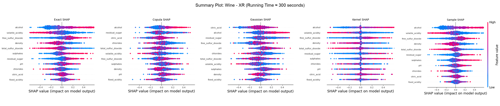

# 1 A Comparative Evaluation of Model-Agnostic SHAP Approximations
Bachelor Thesis Project by BSc. Tim Weichselberger (University of Vienna) supervised by Prof. Sebastian Tschiatschek

This thesis investigates how well standard model-agnostic SHAP approximations align with the evaluation properties of Degree of Importance (RBO), Fidelity (MAE) and Stability (Confidence Interval) across different machine learning models. Unlike previous studies, the approximations are compared at equal runtime instead of equal sample size.

# 2 Key Findings 
The thesis shows that Sample SHAP significantly outperforms the parametric approaches (Multivariate Gaussian SHAP and Gaussian Copula SHAP) in all three evaluation metrics. While Kernel SHAP delivers slightly better results for simpler models, it was outperformed by Sample SHAP in all other cases. Therefore, the results suggest that Sample SHAP
is the most robust method for approximating the Exact SHAP values in runtime-limited settings regarding Degree of Importance, Fidelity and Stability.

The following plot shows, as an example, that Sample SHAP provides better SHAP values in time-limited settings: Sample SHAP delivers very accurate SHAP values, while Kernel SHAP recognizes trends but calculates relatively small SHAP values. In contrast, the parametric methods deviate significantly from the exact result.


XGBoost, Wine dataset, ~300 s runtime per method.

# 3 Requirements
- Python (3.11.12)
- R (4.3.1)
- Git

# 4 Installation

## (a) Package Installation (Python)
requirements.txt includes all needed python packages for this installation (for R packages, see next point)

```bash 
pip install -r requirements.txt
```

## (b) Installation of shapr and R packages (R libraries)
This project is using the shapr implementation for the Gaussian and Copula SHAP approximation. To use shapr the Python wrapper shaprpy is needed.

To install shapr for this project run the script:
```bash 
bash setup_shapr.sh
```

# 5 Start Project 
```bash 
python src/main.py --help
```

# 6 Usage
The main file has multiple modes: train models, compute SHAP values, evaluate SHAP values, load SHAP values and print results. All the necessary information is provided in the main.py file and can be seen when the code of "Start Project" is run.

